# Inventory and Data Management System

## About the Project

This is a simple Inventory Management System built using Node.js, Express.js and MongoDB. It helps manage products, update stock, and generate inventory reports.

## Technologies Used

- Node.js
- Express.js
- MongoDB
- Mongoose
- Postman
- dotenv

## Features

- Add, view, update and delete products.
- Search and filter products.
- Sort and paginate products.
- Restock and sell products.
- Prevent selling more than available stock.
- Generate low-stock reports.
- Generate category-wise inventory reports.
- Product validation and error handling.

## Project Structure

```text
Inventory-Data-Management-System/
├── config/
├── controller/
├── middleware/
├── model/
├── routes/
├── screenshots/
├── .env
├── .gitignore
├── package.json
├── server.js
└── README.md
```

## Installation and Setup

**1. Clone the repository**

```bash
git clone YOUR_GITHUB_REPOSITORY_LINK
```

**2. Install dependencies**

```bash
npm install
```

**3. Create a `.env` file**

```env
PORT=3000
MONGO_URI=your_mongodb_connection_string
```

**4. Start the server**

```bash
node server.js
```

## API Details

Base URL:

```text
http://localhost:3000/api/products
```

### 1. Create Product

- Method: POST
- URL: `/api/products`

**Body:**

```json
{
  "name": "HP Laptop",
  "category": "Electronics",
  "price": 55000,
  "quantity": 10,
  "description": "HP Laptop with 8GB RAM",
  "lowStockLimit": 5
}
```

### 2. Get All Products

- Method: GET
- URL: `/api/products`

### 3. Filter Products

- Method: GET
- URL: `/api/products?category=Electronics`

### 4. Search Products

- Method: GET
- URL: `/api/products?search=Laptop`

### 5. Sort Products

- Method: GET
- URL: `/api/products?sort=price`

Use `sort=-price` for descending order.

### 6. Pagination

- Method: GET
- URL: `/api/products?page=1&limit=5`

### 7. Get Single Product

- Method: GET
- URL: `/api/products/:id`

### 8. Update Product

- Method: PUT
- URL: `/api/products/:id`

**Body:**

```json
{
  "name": "HP Laptop Updated",
  "category": "Electronics",
  "price": 60000,
  "quantity": 15,
  "description": "Updated HP Laptop",
  "lowStockLimit": 5
}
```

### 9. Restock Product

- Method: PATCH
- URL: `/api/products/:id/restock`

**Body:**

```json
{
  "quantity": 10
}
```

### 10. Sell Product

- Method: PATCH
- URL: `/api/products/:id/sell`

**Body:**

```json
{
  "quantity": 4
}
```

### 11. Delete Product

- Method: DELETE
- URL: `/api/products/:id`

### 12. Low Stock Report

- Method: GET
- URL: `/api/products/reports/low-stock`

### 13. Category-wise Inventory Report

- Method: GET
- URL: `/api/products/reports/category`

## API Testing Screenshots

All APIs were tested using Postman.

### 1. Create Products

**HP Laptop**

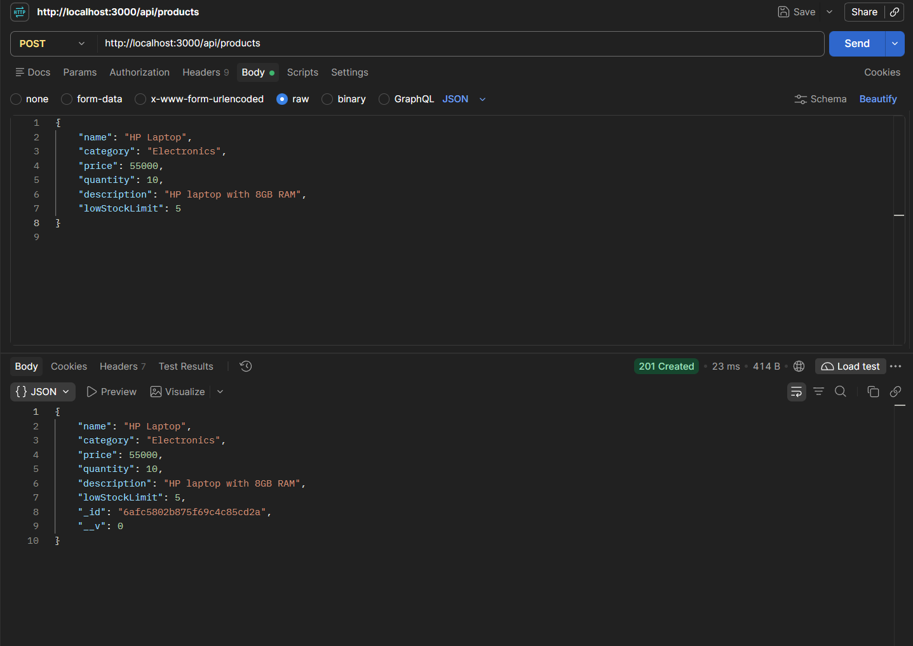

**Wireless Mouse**

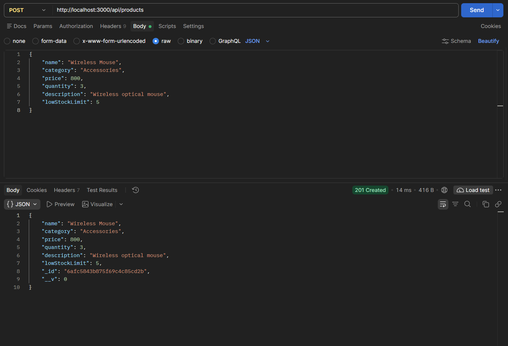

**Mechanical Keyboard**

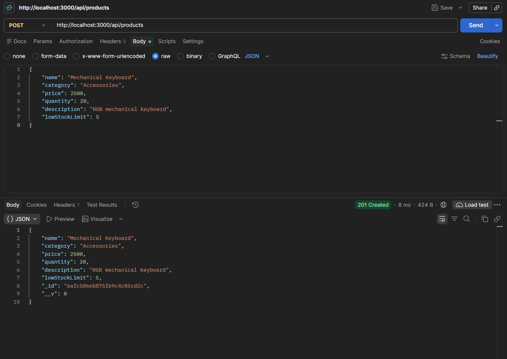

### 2. Get All Products

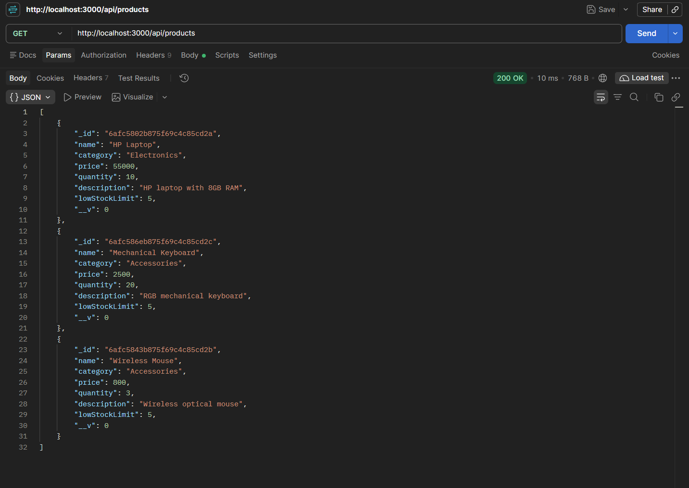

### 3. Pagination (Page & Limit)

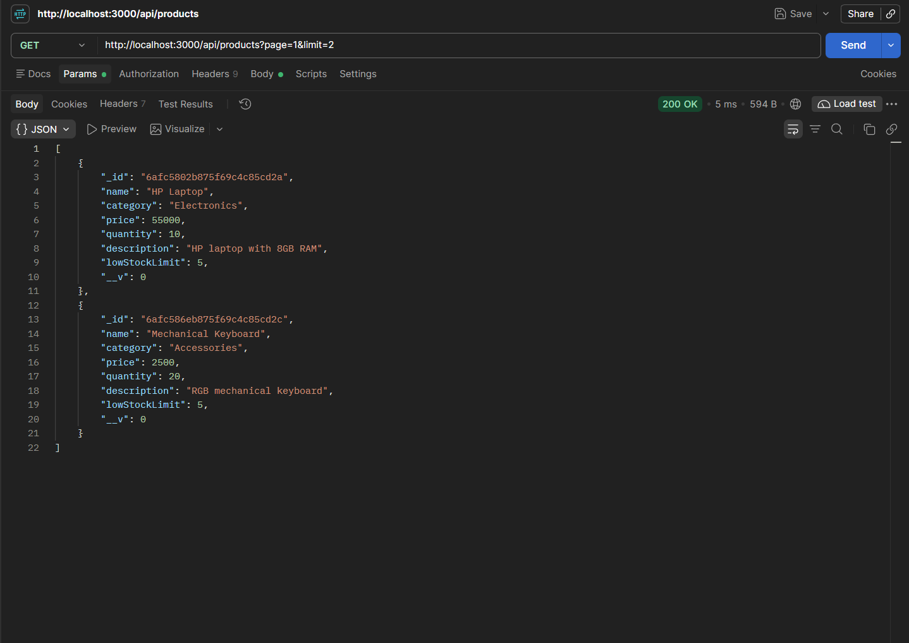

### 4. Get Single Product

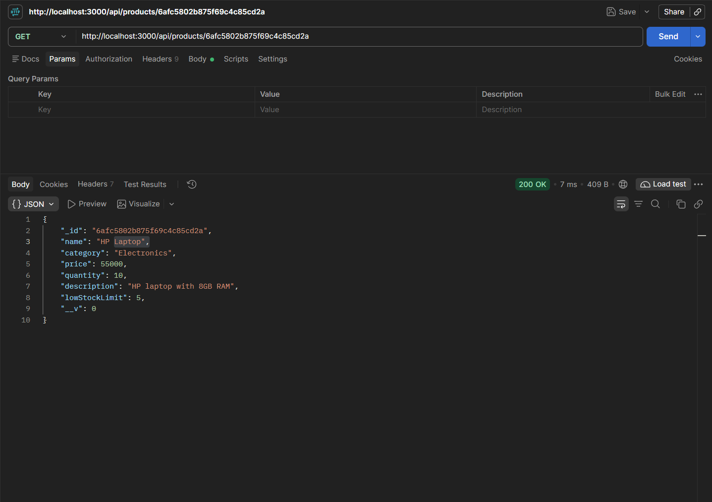

### 5. Update Product

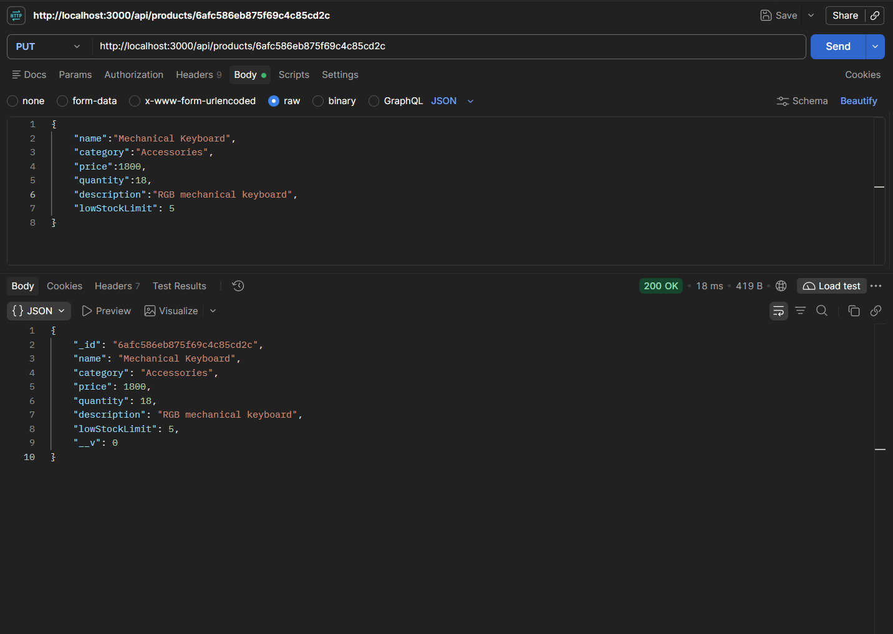

### 6. Restock Product

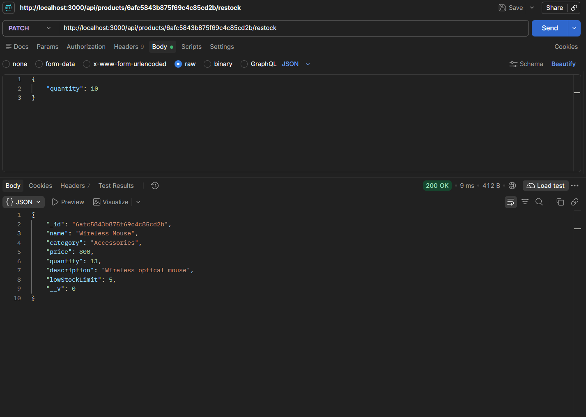

### 7. First Sell Operation

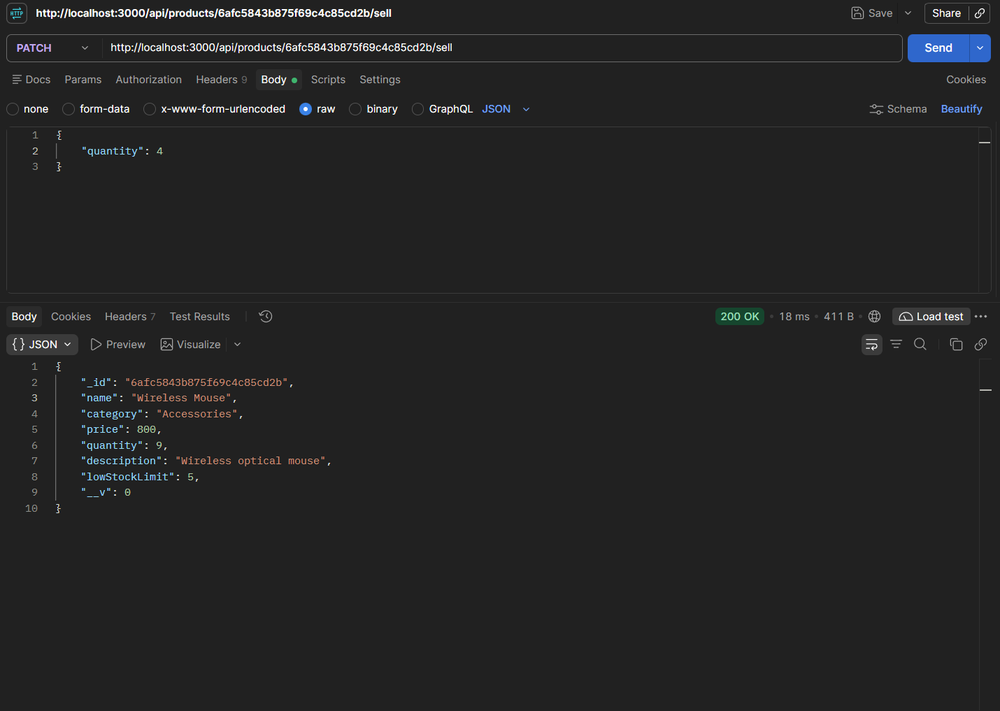

### 8. Second Sell Operation

The second sell operation reduces the product quantity below its low-stock limit.


### 9. Low Stock Report

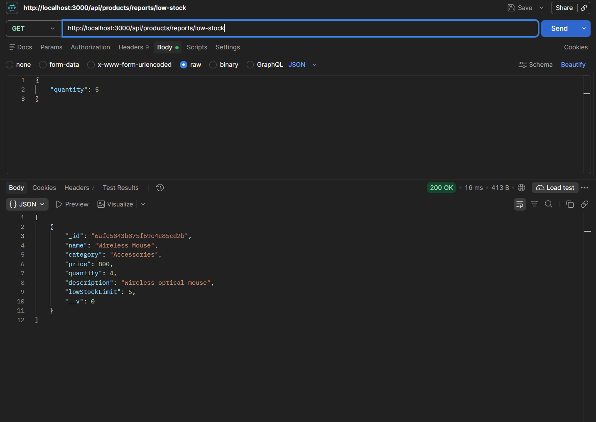

### 10. Category-wise Report

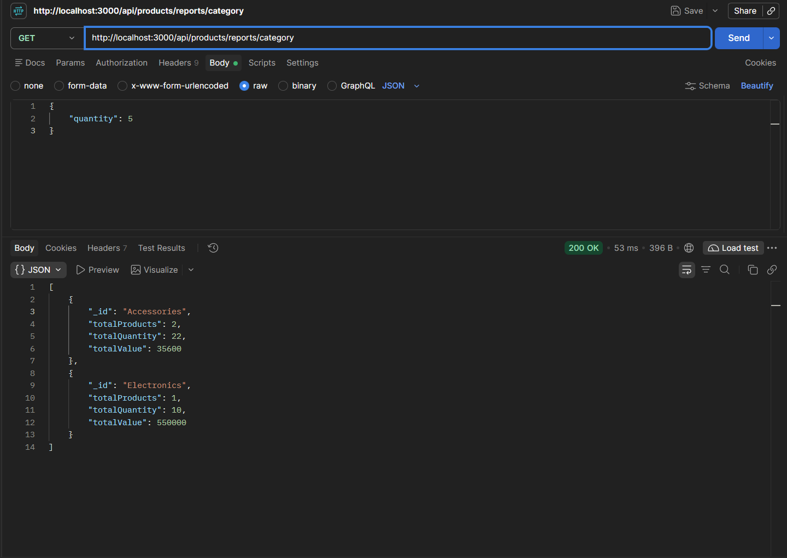

### 11. Delete Product

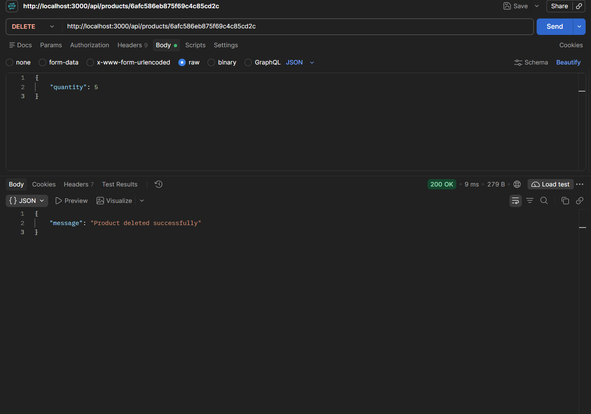
